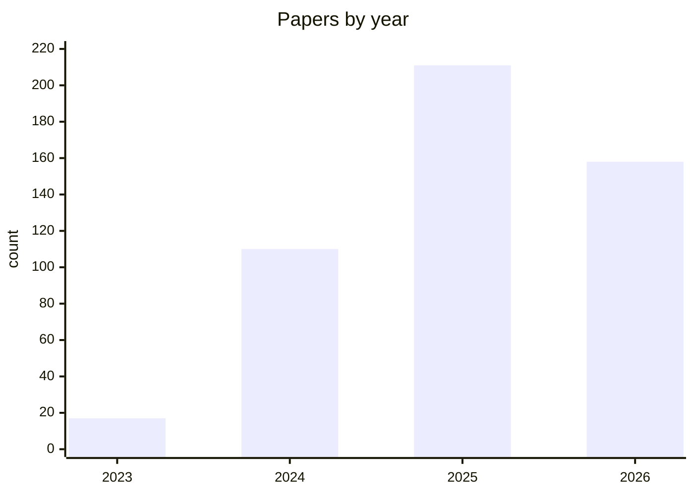
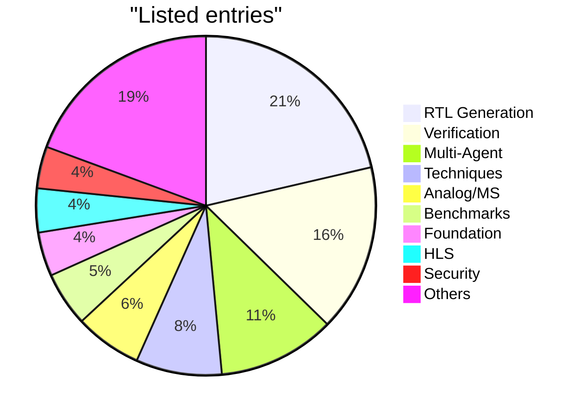

    

# 🧠⚡ Awesome AI for Chip Design

> **A curated, community-maintained list of ML/LLM research & tools across the chip-design flow — from specification to silicon.**

Artificial intelligence — large language models in particular — is reshaping how chips are designed, verified, and optimized. This list tracks research and open tools that apply ML/LLMs across the chip-design flow: specification and high-level synthesis, RTL generation, verification and debug, logic and physical synthesis, PPA optimization, analog and mixed-signal, FPGA, testing, and hardware security — plus the foundation models, benchmarks, datasets, techniques, and multi-agent frameworks that underpin them.

Inclusion does not imply endorsement; categories are best-effort and subjective — please open an issue or PR to correct them.

## 📊 At a glance

| 📦 Papers | 🗂️ Categories | 📅 Span | 📝 Listed entries |
|---|---|---|---|
| **496** | **17** | **2023–2026** | **501** |

**📅 Papers by year**

**🥧 Listed entries by category** (top 9 + others)

## Contents

- 🧱 [Front-end Design](#front-end-design)
  - 📋 [Specification & System-Level](#specification-system-level)
  - ⚙️ [High-Level Synthesis](#high-level-synthesis)
  - 🔣 [RTL Generation](#rtl-generation)
  - ✅ [Verification & Testbench](#verification-testbench)
  - 🐛 [Bug Fixing & Debug](#bug-fixing-debug)
- 🏗️ [Back-end Design](#back-end-design)
  - 🔀 [Logic Synthesis](#logic-synthesis)
  - 📐 [Physical Design & PPA](#physical-design-ppa)
- 🌐 [Domains](#domains)
  - 📡 [Analog & Mixed-Signal](#analog-mixed-signal)
  - 🧩 [FPGA](#fpga)
  - 🔒 [Hardware Security](#hardware-security)
  - ⚡ [AI Accelerator & Architecture](#ai-accelerator-architecture)
- 🏛️ [Foundations & Infrastructure](#foundations-infrastructure)
  - 🧠 [Foundation Models](#foundation-models)
  - 🗂️ [Benchmarks & Datasets](#benchmarks-datasets)
  - 🛠️ [Techniques (RAG/RL/Prompt/FT)](#techniques-ragrlpromptft)
  - 🤖 [Multi-Agent Systems](#multi-agent-systems)
  - 🛰️ [EDA Tools & Copilots](#eda-tools-copilots)
- 📚 [Surveys & Reviews](#surveys-reviews)

## 🧱 Front-end Design

### 📋 Specification & System-Level

- [AGON: Automated Design Framework for Customizing Processors from ISA Documents](https://arxiv.org/abs/2412.20954) - (2024).
- [Are Open-Source EDA Tools Ready for a Multi-Million-Gate, Linux-Booting RV64 SoC Design?](https://arxiv.org/abs/2405.04257) - (2024).
- [HWE-Bench: Can Language Models Perform Board-level Schematic Designs?](https://arxiv.org/abs/2603.18102) - (2026).
- [PCBSchemaGen: Constraint-Guided Schematic Design via LLM for Printed Circuit Boards (PCB)](https://arxiv.org/abs/2602.00510) - (2026).
- [SchGen: PCB Schematic Generation with Semantic-Grounded Code Representations](https://arxiv.org/abs/2605.30345) - (2026).
### ⚙️ High-Level Synthesis

- [A Benchmark and Framework for Evaluating LLMs on High-Level Synthesis Design Tasks](https://arxiv.org/abs/2504.12268) - (2025).
- [Agentic-HLS: An agentic reasoning based high-level synthesis system using large language models (AI for EDA workshop 2024)](https://arxiv.org/abs/2412.01604) - (2024).
- [Are LLMs Any Good for High-Level Synthesis?](https://arxiv.org/abs/2408.10428) - (2024).
- [AutoBeaVer: Automating Behavioral Modeling and Verification in Library Characterization with LLM Agents](https://ieeexplore.ieee.org/abstract/document/11534699/) - (2026).
- [Bench4HLS: End-to-End Evaluation of LLMs in High-Level Synthesis Code Generation](https://arxiv.org/abs/2601.19941) - (2026).
- [Can Reasoning Models Reason about Hardware? An Agentic HLS Perspective](https://arxiv.org/abs/2503.12721) - (2025).
- [ChatHLS: Towards Systematic Design Automation and Optimization for High-Level Synthesis](https://arxiv.org/abs/2507.00642) - (2025).
- [CorrectHDL: Agentic HDL Design with LLMs Leveraging High-Level Synthesis as Reference](https://arxiv.org/abs/2511.16395) - (2025).
- [Dataset for LLM-Driven C-to-HLS Hardware Code Synthesis](https://arxiv.org/abs/2507.04315) - (2025).
- [DiffHLS: Differential Learning for High-Level Synthesis QoR Prediction with GNNs and LLM Code Embeddings](https://arxiv.org/abs/2604.09240) - (2026).
- [Evaluating Large Language Models for Automatic Register Transfer Logic Generation via High-Level Synthesis](https://arxiv.org/abs/2408.02793) - (2024).
- [From Pragmas to Partners: A Symbiotic Evolution of Agentic High-Level Synthesis](https://arxiv.org/abs/2602.01401) - (2026).
- [HLS-Eval: A Benchmark and Framework for Evaluating LLMs on High-Level Synthesis Design Tasks](https://scholar.google.com/scholar?q=HLS-Eval%3A+A+Benchmark+and+Framework+for+Evaluating+LLMs+on+High-Level+Synthesis+Design+Tasks) - (2025).
- [HLSTester: Efficient Testing of Behavioral Discrepancies with LLMs for High-Level Synthesis](https://ieeexplore.ieee.org/abstract/document/11240891/) - (2025).
- [Iceberg: Enhancing HLS Modeling with Synthetic Data](https://arxiv.org/abs/2507.09948) - (2025).
- [Intelligent4DSE: Optimizing High-Level Synthesis Design Space Exploration with Graph Neural Networks and Large Language Models](https://arxiv.org/abs/2504.19649) - (2025).
- [LLM-Based Pragma Insertion for HLS via GNN Supervised Fine-Tuning](https://arxiv.org/abs/2504.21187) - (2025).
- [LLM-Based Timing-Aware and Architecture-Specific FPGA HLS Optimization](https://arxiv.org/abs/2507.17962) - (2025).
- [LLM-Driven C-to-Verilog Translation via HLS with Automated Verification](https://ieeexplore.ieee.org/abstract/document/11504558/) - (2026).
- [Optimizing High-Level Synthesis Designs with Retrieval-Augmented Large Language Models](https://arxiv.org/abs/2410.07356) - (2024).
- [Syntax-Aware AST-Guided LLM for High-Level Synthesis Code Generation](https://arxiv.org/abs/2508.03558) - (2025).
### 🔣 RTL Generation

- [A Code Translation Dataset for Enhanced LLM Verilog Generation](https://arxiv.org/abs/2506.04544) - (2025).
- [A Deep Learning Framework for Verilog Autocompletion Towards Design and Verification Automation](https://arxiv.org/abs/2304.13840) - (2023).
- [A LLM-based Multi-Agent Framework for Automated TCAD Code Generation and Device Optimization](https://arxiv.org/abs/2512.23742) - (2025).
- [A Model-Agnostic Retrieval-Augmented Framework for Verilog Code Generation with a High-Quality Knowledge Base](https://arxiv.org/abs/2510.05327) - (2025).
- [A Multi-Expert Large Language Model Architecture for Verilog Code Generation](https://arxiv.org/abs/2404.08029) - (2024).
- [A New Benchmark for the Appropriate Evaluation of RTL Code Optimization](https://arxiv.org/abs/2601.01765) - (2026).
- [A Systematic Framework for Automated Verilog Code Generation using LLMs](https://arxiv.org/abs/2407.18333) - (2024).
- [Advanced Large Language Model (LLM)-Driven Verilog Development](https://arxiv.org/abs/2312.01022) - (2023).
- [Agentic LLM for Automated Verilog Generation with a Novel Evaluation Metric](https://arxiv.org/abs/2503.16514) - (2025).
- [AI-Driven RTL Generation with Verification In-The-Loop](https://arxiv.org/abs/2409.11411) - (2024).
- [An Evolutionary Framework for RTL Generation driven by Large Language Models](https://arxiv.org/abs/2510.21407) - (2025).
- [An Iterative Framework for Fine-tuning LLMs for RTL Code Generation](https://arxiv.org/abs/2407.12022) - (2024).
- [Automatically Improving LLM-based Verilog Generation using EDA Tool Feedback](https://arxiv.org/abs/2411.11856) - (2024).
- [Autonomous Verilog Coding Agents with Graph-based Planning and AST-based Waveform Tracing](https://arxiv.org/abs/2408.08927) - (2024).
- [Autosilicon: Scaling up rtl design generation capability of large language models](https://dl.acm.org/doi/abs/10.1145/3737286) - (2025).
- [AutoVeriFix+: High-Correctness RTL Generation via Trace-Aware Causal Fix and Semantic Redundancy Pruning](https://arxiv.org/abs/2603.11489) - (2026).
- [Boosting the LLM-Based RTL Generation with Multi-Stage Diversity-Oriented Reinforcement Learning](https://arxiv.org/abs/2603.27630) - (2026).
- [Chain-of-Descriptions: Improving Code LLMs for VHDL Code Generation and Summarization](https://arxiv.org/abs/2507.12308) - (2025).
- [ChatCPU: An Agile CPU Design and Verification Platform with LLM](https://doi.org/10.1145/3649329.3658493) - (2024).
- [ChipCraftBrain: Validation-First RTL Generation via Multi-Agent Orchestration](https://arxiv.org/abs/2604.19856) - (2026).
- [ChipMATE: Multi-Agent Training via Reinforcement Learning for Enhanced RTL Generation](https://arxiv.org/abs/2605.12857) - (2026).
- [Classification-Based Automatic HDL Code Generation Using LLMs](https://arxiv.org/abs/2407.18326) - (2024).
- [Closing the Loop in LLM-Based Hardware Generation: An Autonomous Agentic Workflow for Robust TPU Design](https://ieeexplore.ieee.org/abstract/document/11563407/) - (2026).
- [CodeV: Empowering LLMs with HDL Generation through Multi-Level Summarization](https://arxiv.org/abs/2407.10424) - (2024).
- [COEVO: Co-Evolutionary Framework for Joint Functional Correctness and PPA Optimization in LLM-Based RTL Generation](https://arxiv.org/abs/2604.15001) - (2026).
- [Controlled Verilog Generation with Discriminative Guidance](https://arxiv.org/abs/2402.03375) - (2024).
- [CoopetitiveV: Leveraging LLM-powered Coopetitive Multi-Agent Prompting for High-quality Verilog Generation](https://arxiv.org/abs/2412.11014) - (2024).
- [Correct and Compositional Hardware Generators](https://arxiv.org/abs/2401.02570) - (2024).
- [DecoRTL: A Run-time Decoding Framework for RTL Code Generation with LLMs](https://arxiv.org/abs/2507.02226) - (2025).
- [DeepCircuitX: A Comprehensive Repository-Level Dataset for RTL Code Understanding, Generation, and PPA Analysis](https://scholar.google.com/scholar?q=DeepCircuitX%3A+A+Comprehensive+Repository-Level+Dataset+for+RTL+Code+Understanding%2C+Generation%2C+and+PPA+Analysis) - (2025).
- [Deterministic Verilog Code Synthesis from LLM-Generated Conjunctive Normal Form](https://arxiv.org/abs/2506.00005) - (2025).
- [Digital ASIC Design with Ongoing LLMs](https://arxiv.org/abs/2405.02329) - (2024).
- [EDA-Aware RTL Generation with Large Language Models](https://arxiv.org/abs/2412.04485) - (2024).
- [Effective Automatic Chisel Code Generation by LLM with Reflection](https://arxiv.org/abs/2505.19734) - (2025).
- [Empowering LLMs for Verilog Generation through Multi-Level Summarization](https://api.emergentmind.com/papers/2407.10424) - (2024).
- [Enhancing LLM-Based RTL Code Generation through Functional Correctness Validation](https://arxiv.org/abs/2504.15659) - (2025).
- [Enhancing RTL Code Generation with Code-to-Code Augmentation and Self-Reflection](https://arxiv.org/abs/2407.16237) - (2024).
- [Entropy-Aware RL Alignment of LLMs for Reliable RTL Code Generation](https://arxiv.org/abs/2511.12033) - (2025).
- [Evaluating Creativity of LLM-Based Hardware Code Generation](https://arxiv.org/abs/2404.08806) - (2024).
- [Evaluating Large Language Models for Verilog Code Generation](https://arxiv.org/abs/2309.07544) - (2023).
- [Evolutionary Search for LLM-based Verilog Generation and Optimization](https://arxiv.org/abs/2601.18067) - (2026).
- [EvoVerilog: Large Langugage Model Assisted Evolution of Verilog Code](https://arxiv.org/abs/2508.13156) - (2025).
- [Exploiting Information Locality for IP-level Verilog Generation](https://arxiv.org/abs/2602.00704) - (2026).
- [Exploring LLM-based Verilog Code Generation with Data-Efficient Fine-Tuning and Testbench Automation](https://ieeexplore.ieee.org/abstract/document/11527691/) - (2026).
- [Faver: Boosting LLM-based RTL Generation with Function Abstracted Verifiable Middleware](https://arxiv.org/abs/2510.08664) - (2025).
- [FedChip: Federated LLM for Artificial Intelligence Accelerator Chip Design](https://scholar.google.com/scholar?q=FedChip%3A+Federated+LLM+for+Artificial+Intelligence+Accelerator+Chip+Design) - (2025).
- [Fully Open-Source and Efficient LLM-Assisted RTL Code Generation Technique](https://arxiv.org/abs/2312.08617) - (2023).
- [Generating Human-Surpassing RTL with LLM via Hierarchical Reward-Driven Reinforcement Learning](https://arxiv.org/abs/2507.04736) - (2025).
- [Hallucination-Mitigated LLM for Verilog Code Generation Aligned with HDL Engineers](https://arxiv.org/abs/2501.04908) - (2025).
- [HDLCoRe: A Training-Free Framework for Mitigating Hallucinations in LLM-Generated HDL](https://scholar.google.com/scholar?q=HDLCoRe%3A+A+Training-Free+Framework+for+Mitigating+Hallucinations+in+LLM-Generated+HDL) - (2025).
- [HiVeGen – Hierarchical LLM-based Verilog Generation for Scalable Chip Design](https://arxiv.org/abs/2412.05393) - (2024).
- [Hivegen–hierarchical llm-based verilog generation for scalable chip design](https://ieeexplore.ieee.org/abstract/document/11105878/) - (2025).
- [How far are we from natural language hardware design](https://arxiv.org/abs/2305.14019) - (2023).
- [HYPERHEURIST: A Simulated Annealing-Based Control Framework for LLM-Driven Code Generation in Optimized Hardware Design](https://arxiv.org/abs/2604.15642) - (2026).
- [Hyperparameter Sensitivity Exceeds Model Differences in Open-Source LLMs for RTL Generation](https://arxiv.org/abs/2604.17102) - (2026).
- [IncreRTL: Traceability-Guided Incremental RTL Generation under Requirement Evolution](https://arxiv.org/abs/2603.25769) - (2026).
- [Interpretable and Verifiable Hardware Generation with LLM-Driven Stepwise Refinement](https://arxiv.org/abs/2606.19387) - (2026).
- [Large Language Model for Verilog Code Generation](https://arxiv.org/abs/2512.00020) - (2025).
- [Large Language Model for Verilog Generation with Code-Structure-Guided Reinforcement Learning](https://arxiv.org/abs/2407.18271) - (2024).
- [LLM Unlearning for Reliable Hardware Code Generation](https://arxiv.org/abs/2512.05341) - (2025).
- [LLM-based Behaviour Driven Development for Hardware Design](https://arxiv.org/abs/2512.17814) - (2025).
- [LLM-based High-Quality RTL Code Generation Using MCTS](https://arxiv.org/abs/2402.03289) - (2024).
- [LLM-FSM: Scaling Large Language Models for Finite-State Reasoning in RTL Code Generation](https://arxiv.org/abs/2602.07032) - (2026).
- [LLM4RTL: Tool-Assisted LLM for RTL Generation](https://arxiv.org/abs/2606.15500) - (2026).
- [Multi-grained Dataset Towards Enhanced LLM-assisted Verilog Generation](https://arxiv.org/abs/2407.01910) - (2024).
- [Natural Language Exploration of Hardware Designs and Libraries](https://arxiv.org/abs/2407.12749) - (2024).
- [Natural language is not enough: Benchmarking multi-modal generative AI for Verilog generation](https://arxiv.org/abs/2407.08473) - (2024).
- [NotSoTiny: A Large, Living Benchmark for RTL Code Generation](https://arxiv.org/abs/2512.20823) - (2025).
- [Open Dataset and Benchmark for LLM-Aided Design RTL Generation](https://arxiv.org/abs/2503.15112) - (2025).
- [OpenRTLSet: A Fully Open-Source Dataset for Large Language Model-based Verilog Module Design](https://scholar.google.com/scholar?q=OpenRTLSet%3A+A+Fully+Open-Source+Dataset+for+Large+Language+Model-based+Verilog+Module+Design) - (2025).
- [Paradigm-Based Automatic HDL Code Generation Using LLMs](https://arxiv.org/abs/2501.12702) - (2025).
- [Power, Performance, and Area Optimization aware Verilog Code Generation with Large Language Models](https://arxiv.org/abs/2510.15899) - (2025).
- [PPA-Aware High-Quality Verilog Generation via Multi-Role LLMs](https://arxiv.org/abs/2507.14776) - (2025).
- [ProtocolLLM: RTL Benchmark for SystemVerilog Generation of Communication Protocols](https://arxiv.org/abs/2506.07945) - (2025).
- [Python-based DSL for generating Verilog model of Synchronous Digital Circuits](https://arxiv.org/abs/2406.09208) - (2024).
- [QiMeng-CodeV-R1: Reasoning-Enhanced Verilog Generation](https://arxiv.org/abs/2505.24183) - (2025).
- [QiMeng-CRUX: Narrowing the Gap Between Natural Language and Verilog via Core Refined Understanding eXpression for Circuit Design](https://arxiv.org/abs/2511.20099) - (2025).
- [QiMeng-SALV: Signal-Aware Learning for Verilog Code Generation](https://arxiv.org/abs/2510.19296) - (2025).
- [RealBench: Benchmarking Verilog Generation Models with Real-World IP Designs](https://arxiv.org/abs/2507.16200) - (2025).
- [ROSUM-MCTS: Monte Carlo Tree Search-Inspired HDL Code Summarization with Structural Rewards](https://scholar.google.com/scholar?q=ROSUM-MCTS%3A+Monte+Carlo+Tree+Search-Inspired+HDL+Code+Summarization+with+Structural+Rewards) - (2025).
- [RTL++: Graph-enhanced LLM for RTL Code Generation](https://scholar.google.com/scholar?q=RTL%2B%2B%3A+Graph-enhanced+LLM+for+RTL+Code+Generation) - (2025).
- [RTL-BenchMT: Dynamic Maintenance of RTL Generation Benchmark Through Agent-Assisted Analysis and Revision](https://arxiv.org/abs/2605.15537) - (2026).
- [RTL-Forge: CNF-Anchored, LLM-Assisted Verilog Generation](https://ieeexplore.ieee.org/abstract/document/11563358/) - (2026).
- [Spec2RTL-Agent: Automated Hardware Code Generation from Complex Specifications Using LLM Agent Systems](https://scholar.google.com/scholar?q=Spec2RTL-Agent%3A+Automated+Hardware+Code+Generation+from+Complex+Specifications+Using+LLM+Agent+Systems) - (2025).
- [Survey and Benchmarking of Large Language Models for RTL Code Generation: Techniques and Open Challenges](https://www.preprints.org/manuscript/202509.1681) - (2025).
- [SymRTLO: Enhancing RTL Code Optimization with LLMs and Neuron-Inspired Symbolic Reasoning](https://arxiv.org/abs/2504.10369) - (2025).
- [Syntax-Aware AST-Guided LLM for High-Level Synthesis Code Generation](https://arxiv.org/abs/2508.03558) - (2025).
- [Synthesis-in-the-Loop Evaluation of LLMs for RTL Generation](https://arxiv.org/abs/2603.11287) - (2026).
- [The Largest, Highest-Quality Dataset with a Preprocessing Framework for LLM-based RTL Generation](https://arxiv.org/abs/2507.13369) - (2025).
- [Towards llm-powered verilog rtl assistant: Self-verification and self-correction](https://arxiv.org/abs/2406.00115) - (2024).
- [TPU-Gen: LLM-Driven Custom Tensor Processing Unit Generator](https://scholar.google.com/scholar?q=TPU-Gen%3A+LLM-Driven+Custom+Tensor+Processing+Unit+Generator) - (2025).
- [Unleashing the Power of Reasoning LLMs for Chisel Agile Hardware Development](https://arxiv.org/abs/2504.19144) - (2025).
- [VeriContaminated: Assessing LLM-Driven Verilog Coding for Data Contamination](https://scholar.google.com/scholar?q=VeriContaminated%3A+Assessing+LLM-Driven+Verilog+Coding+for+Data+Contamination) - (2025).
- [VeriDispatcher: Multi-Model Dispatching through Pre-Inference Difficulty Prediction for RTL Generation Optimization](https://arxiv.org/abs/2511.22749) - (2025).
- [VeriGraphi: A Multi-Agent Framework of Hierarchical RTL Generation for Large Hardware Designs](https://arxiv.org/abs/2604.14550) - (2026).
- [VeriLeaky: Navigating IP Protection vs Utility in Fine-Tuning for LLM-Driven Verilog Coding](https://scholar.google.com/scholar?q=VeriLeaky%3A+Navigating+IP+Protection+vs+Utility+in+Fine-Tuning+for+LLM-Driven+Verilog+Coding) - (2025).
- [Veriloc: Line-of-code level prediction of hardware design quality from verilog code](https://proceedings.neurips.cc/paper_files/paper/2025/hash/141ad4ee52ba0b1db87483cb8f173c4e-Abstract-Conference.html) - (2026).
- [Verilog Code Generation of Hierarchical Design Using LLMs](https://ieeexplore.ieee.org/abstract/document/11189211/) - (2025).
- [Verilog-Evolve: Feedback-Driven and Skill-Evolving Verilog Generation](https://arxiv.org/abs/2605.26498) - (2026).
- [VerilogCL: A Contrastive Learning Framework for Robust LLM-Based Verilog Generation](https://arxiv.org/abs/2604.18162) - (2026).
- [VerilogMonkey: Exploring Parallel Scaling for Automated Verilog Code Generation with LLMs](https://arxiv.org/abs/2509.16246) - (2025).
- [VeriMoA: A Mixture-of-Agents Framework for Spec-to-HDL Generation](https://arxiv.org/abs/2510.27617) - (2025).
- [VeriReason: Reinforcement Learning with Testbench Feedback for Reasoning-Enhanced Verilog Generation](https://arxiv.org/abs/2505.11849) - (2025).
- [VFocus: Better Verilog Generation from Large Language Model via Focused Reasoning](https://arxiv.org/abs/2511.02285) - (2025).
- [Vgv: Verilog generation using visual capabilities of multi-modal large language models](https://ieeexplore.ieee.org/abstract/document/10691753/) - (2024).
- [VHDL-Eval: A Framework for Evaluating Large Language Models in VHDL Code Generation](https://arxiv.org/abs/2406.04379) - (2024).
- [VRank: Enhancing Verilog Code Generation from Large Language Models via Self-Consistency](https://arxiv.org/abs/2502.00028) - (2025).
### ✅ Verification & Testbench

- [(Security) Assertions by Large Language Models](https://arxiv.org/abs/2306.14027) - (2023).
- [A Large Language Model for Solving Assertion Failures in RTL Design](https://arxiv.org/abs/2503.04057) - (2025).
- [A LoRA Fine-Tuned LLM Model for Efficient Automated Assertion Generation](https://arxiv.org/abs/2508.07371) - (2025).
- [A Multi-Agent Generative AI Framework for IC Module-Level Verification Automation](https://arxiv.org/abs/2507.21694) - (2025).
- [A Retrieval-Augmented Framework for Automated RTL Testability Repair](https://arxiv.org/abs/2507.15664) - (2025).
- [AI-Assisted Hardware Security Verification](https://arxiv.org/abs/2604.01572) - (2026).
- [AI-Driven RTL Generation with Verification In-The-Loop](https://arxiv.org/abs/2409.11411) - (2024).
- [An AST-guided LLM Approach for SVRF Code Synthesis](https://scholar.google.com/scholar?q=An+AST-guided+LLM+Approach+for+SVRF+Code+Synthesis) - (2025).
- [an Automated LLM-aided UVM Machine for RTL Verification](https://arxiv.org/abs/2504.19959) - (2025).
- [an Automated LLM-aided UVM Machine for Subsystem-level RTL Verification](https://arxiv.org/abs/2605.04704) - (2026).
- [An Automated Universal RTL Verification Framework using LLMs](https://arxiv.org/abs/2411.16238) - (2024).
- [An Efficient Program Generation Multi-Agent System for Automatic RTL Verification](https://arxiv.org/abs/2506.12200) - (2025).
- [Analogtester: A large language model-based framework for automatic testbench generation in analog circuit design](https://ieeexplore.ieee.org/abstract/document/11100397/) - (2025).
- [Architect in the Loop Agentic Hardware Design and Verification](https://arxiv.org/abs/2512.00016) - (2025).
- [Are LLMs Ready for Practical Adoption for Assertion Generation?](https://arxiv.org/abs/2502.20633) - (2025).
- [Assertain: Automated Security Assertion Generation Using Large Language Models](https://arxiv.org/abs/2604.01583) - (2026).
- [AssertFix: Empowering Automated Assertion Fix via Large Language Models](https://arxiv.org/abs/2509.23972) - (2025).
- [AssertGen: Enhancement of LLM-aided Assertion Generation through Cross-Layer Signal Bridging](https://arxiv.org/abs/2509.23674) - (2025).
- [AssertionBench: A Benchmark to Evaluate Large-Language Models for Assertion Generation](https://arxiv.org/abs/2406.18627) - (2024).
- [AssertionForge: Enhancing Formal Verification Assertion Generation with Structured Representation of Specifications and RTL](https://arxiv.org/abs/2503.19174) - (2025).
- [Assertllm: Generating and evaluating hardware verification assertions from design specifications via multi-llms](https://arxiv.org/abs/2402.00386) - (2024).
- [Automated RTL Design with Backtrack-ToT](https://arxiv.org/abs/2511.13139) - (2025).
- [Automated SVA Generation with LLMs](https://arxiv.org/abs/2604.11044) - (2026).
- [Automatic High-quality Verilog Assertion Generation through Subtask-Focused Fine-Tuned LLMs and Iterative Prompting](https://arxiv.org/abs/2411.15442) - (2024).
- [Automatic Testbench Generation and Evaluation Using LLMs for HDL Design](https://arxiv.org/abs/2407.03891) - (2024).
- [Automatic TestBench Generation for Digital Design in the Era of AI](https://mediatum.ub.tum.de/1798701) - (2026).
- [Automating Hardware Design and Verification from Architectural Papers via a Neural-Symbolic Graph Framework](https://arxiv.org/abs/2511.06067) - (2025).
- [Automation of LLM Self-Instructing for Hardware Security Verification](https://arxiv.org/abs/2405.12347) - (2024).
- [Bridging RTL and Assertion Generation with Large Language Models](https://ieeexplore.ieee.org/abstract/document/11419104/) - (2026).
- [Can LLMs Design Real Hardware? A New Benchmark for RTL Design and Verification Tasks](https://openreview.net/forum) - (2024).
- [Can LLMs do Induction Proofs for Hardware?](https://arxiv.org/abs/2511.02521) - (2025).
- [ChatSVA: Bridging SVA Generation for Hardware Verification via Task-Specific LLMs](https://arxiv.org/abs/2604.02811) - (2026).
- [Chattest: Coverage-enhanced testbench generation for agile hardware verification with llms](https://ieeexplore.ieee.org/abstract/document/11539733/) - (2026).
- [ChIRAAG: ChatGPT Informed Rapid and Automated Assertion Generation](https://arxiv.org/abs/2402.00093) - (2024).
- [ConfiBench: Automatic Testbench Generation with Confidence-Based Scenario Mask and Testbench Ensemble using LLMs for HDL Design](https://dl.acm.org/doi/abs/10.1145/3773087) - (2026).
- [CorrectBench: Automatic Testbench Generation with Functional Self-Correction using LLMs for HDL Design](https://arxiv.org/abs/2411.08510) - (2024).
- [CoverAssert: Iterative LLM Assertion Generation Driven by Functional Coverage via Syntax-Semantic Representations](https://arxiv.org/abs/2604.06607) - (2026).
- [DeepAssert: An LLM-Aided Verification Framework with Fine-Grained Assertion Generation for Modules with Extracted Module Specifications](https://arxiv.org/abs/2509.14668) - (2025).
- [EDA-in-the-Loop: Automated HDL Code Generation and Verification Using Multi-Agent LLMs](https://ieeexplore.ieee.org/abstract/document/11404766/) - (2025).
- [Embedded Tutorial: AI Vs. Verification Engineer: Fight or Synergy?](https://ieeexplore.ieee.org/abstract/document/11520998/) - (2026).
- [Enhancing Large Language Models for Hardware Verification](https://arxiv.org/abs/2503.08923) - (2025).
- [Exploring Agentic LLM Paradigms for Hardware Verification across Abstraction Levels](https://ieeexplore.ieee.org/abstract/document/11563224/) - (2026).
- [From Indiscriminate to Targeted: Efficient RTL Verification via Functionally Key Signal-Driven LLM Assertion Generation](https://arxiv.org/abs/2604.08932) - (2026).
- [From Language to Logic: Bridging LLMs & Formal Representations for RTL Assertion Generation](https://arxiv.org/abs/2604.23100) - (2026).
- [FVRuleLearner: Operator-Level Reasoning Tree (OP-Tree)-Based Rules Learning for Formal Verification](https://arxiv.org/abs/2604.03245) - (2026).
- [GenAI through the Lens of Formal Verification](https://arxiv.org/abs/2403.16750) - (2024).
- [Generating Hardware Verification Assertions from Design Specifications via Multi-LLMs](https://arxiv.org/abs/2402.00386) - (2024).
- [Hardware Design and Verification with Large Language Models: A Literature Survey, Challenges, and Open Issues](https://www.researchgate.net/publication/385564600) - (2025).
- [HAVEN: Hybrid Automated Verification ENgine for UVM Testbench Synthesis with LLMs](https://arxiv.org/abs/2604.27643) - (2026).
- [HDLCoRe: A Training-Free Framework for Mitigating Hallucinations in LLM-Generated HDL](https://scholar.google.com/scholar?q=HDLCoRe%3A+A+Training-Free+Framework+for+Mitigating+Hallucinations+in+LLM-Generated+HDL) - (2025).
- [Hey AI, Generate Me a Hardware Code! Agentic AI-based Hardware Design & Verification](https://arxiv.org/abs/2507.02660) - (2025).
- [HierSVA: A Data Synthesis Pipeline, Dataset, and Benchmark for LLM-Driven Hierarchical Hardware Formal Verification](https://arxiv.org/abs/2606.13706) - (2026).
- [Improving LLM-Based Hardware Test Plan Generation](https://arxiv.org/abs/2601.07593) - (2026).
- [Intermediate Representations for LLM-Based Test Generation: A Comparative Study in Automotive Software Verification](https://gupea.ub.gu.se/items/831f1338-9e17-4ae0-aa12-9ac81de2cf8c) - (2026).
- [Iterative LLM-Based Assertion Generation Using Syntax-Semantic Representations for Functional Coverage-Guided Verification](https://arxiv.org/abs/2602.15388) - (2026).
- [Knowledge Graphs, the Missing Link in Agentic AI-based Formal Verification](https://arxiv.org/abs/2605.06434) - (2026).
- [LLM Assisted Assertion Generation for RTL Design Verification](https://arxiv.org/abs/2409.15281) - (2024).
- [LLM-Aided Hardware Test Generation](https://arxiv.org/abs/2406.04373) - (2024).
- [LLM-aided Test Generation for Custom Neural Network Hardware Accelerators](https://ieeexplore.ieee.org/abstract/document/11049634/) - (2025).
- [Llm-tg: Towards automated test case generation for processors using large language models](https://ieeexplore.ieee.org/abstract/document/10817956/) - (2024).
- [RefEvo: Agentic Design with Co-Evolutionary Verification for Agile Reference Model Generation](https://arxiv.org/abs/2604.24218) - (2026).
- [Reward-Weighted On-Policy Distillation with an Open Property-Equivalence Verifier for NL-to-SVA Generation](https://arxiv.org/abs/2605.13501) - (2026).
- [Saarthi: The First AI Formal Verification Engineer](https://arxiv.org/abs/2502.16662) - (2025).
- [SANGAM: SystemVerilog Assertion Generation via Monte Carlo Tree Self-Refine](https://arxiv.org/abs/2506.13983) - (2025).
- [Semantic-Guided Test Generation using Fine-Tuned LLMs for Validation of Hardware Accelerators](https://ieeexplore.ieee.org/abstract/document/11534681/) - (2026).
- [SHARP: A Comprehensive SystemC HLS Benchmark Suite and LLM-Assisted Testbench Optimization for RTL Coverage Closure](https://ieeexplore.ieee.org/abstract/document/11527986/) - (2026).
- [Spec2Assertion: Automatic Pre-RTL Assertion Generation using Large Language Models with Progressive Regularization](https://arxiv.org/abs/2505.07995) - (2025).
- [SpecAlign: A Semantic Alignment Framework for SystemVerilog Assertion Generation](https://arxiv.org/abs/2605.25181) - (2026).
- [SpecLoop: An Agentic RTL-to-Specification Framework with Formal Verification Feedback Loop](https://arxiv.org/abs/2603.02895) - (2026).
- [Structural Verification for Reliable EDA Code Generation without Tool-in-the-Loop Debugging](https://arxiv.org/abs/2604.18834) - (2026).
- [Structured Testbench Generation for LLM-Driven HDL Design and Verification-Oriented Data Curation](https://arxiv.org/abs/2606.12983) - (2026).
- [SVVHD: An Open-Source and Self-Verified Benchmark Framework for LLM Evaluation in VHDL Code Generation](https://ieeexplore.ieee.org/abstract/document/11563038/) - (2026).
- [The Simulation Semantics of Synthesisable Verilog](https://arxiv.org/abs/2502.19348) - (2025).
- [Training Specialized LLMs for Hardware Assertion Generation via RTL-Grounded Bidirectional Data Synthesis](https://arxiv.org/abs/2603.14239) - (2026).
- [UCAgent: An End-to-End Agent for Block-Level Functional Verification](https://arxiv.org/abs/2603.25768) - (2026).
- [Understanding Language Model Capabilities in Formal Verification of Digital Hardware](https://arxiv.org/abs/2410.23299) - (2024).
- [Using Large Language Models for Hardware Test Stimuli Generation](https://arxiv.org/abs/2310.04535) - (2023).
- [Using LLMs to Facilitate Formal Verification of RTL](https://arxiv.org/abs/2309.09437) - (2023).
- [Veri-Sure: A Contract-Aware Multi-Agent Framework with Temporal Tracing and Formal Verification for Correct RTL Code Generation](https://arxiv.org/abs/2601.19747) - (2026).
- [VeriReason: Reinforcement Learning with Testbench Feedback for Reasoning-Enhanced Verilog Generation](https://arxiv.org/abs/2505.11849) - (2025).
### 🐛 Bug Fixing & Debug

- [A Retrieval-Augmented Framework for Automated RTL Testability Repair](https://arxiv.org/abs/2507.15664) - (2025).
- [A Unified LLM for Verilog Debugging via Contrastive Embedding and Guided Correction](https://arxiv.org/abs/2504.19099) - (2025).
- [ARSP: Automated Repair of Verilog Designs via Semantic Partitioning](https://arxiv.org/abs/2508.16517) - (2025).
- [Benchmarking LLM Agents on Real-World Hardware Bug Repair Tasks](https://arxiv.org/abs/2604.14709) - (2026).
- [Explaining EDA synthesis errors with LLMs](https://arxiv.org/abs/2404.07235) - (2024).
- [High-quality Synthetic Data Generation for Verilog Code Models with Correct-by-Construction Non-Textual Representations and Targeted Code Repair](https://arxiv.org/abs/2409.12993) - (2024).
- [LLM-Powered EDA Log Analysis for Effective Design Debugging](https://www2.eecs.berkeley.edu/Pubs/TechRpts/2025/EECS-2025-48.pdf) - (2025).
- [LLMs And Static Hardware Analysis for Early Detection of RTL Bugs](https://arxiv.org/abs/2504.21770) - (2025).
- [Multi-Agent LLM-Guided Hierarchical Chiplet Design with Adaptive Debugging](https://arxiv.org/abs/2508.14053) - (2025).
- [Prompt Repair for Verified Code and Hardware Generation via Reinforcement Learning](https://arxiv.org/abs/2509.06239) - (2025).
- [Re-thinking RTL Debug Automation using LLMs](https://arxiv.org/abs/2405.06840) - (2024).
- [Reliable RTL Repair Framework with Multi-Agent Fault Localization and Stochastic Tree-of-Thoughts Patch Generation](https://arxiv.org/abs/2511.20090) - (2025).
- [SiliconMind-V1: Multi-Agent Distillation and Debug-Reasoning Workflows for Verilog Code Generation](https://arxiv.org/abs/2603.08719) - (2026).
- [Syntactical Bug and Trojan Pattern Identification in A/MS Circuits using LLM-Enhanced Detection](https://arxiv.org/abs/2408.16018) - (2024).
- [Timing Analysis Agent: Autonomous Multi-Corner Multi-Mode (MCMM) Timing Debugging with Timing Debug Relation Graph](https://arxiv.org/abs/2504.11502) - (2025).
- [Timing Violation-Aware Debugging of RTL Code using Large Language Models](https://arxiv.org/abs/2508.13257) - (2025).
- [Understanding and Mitigating Errors of LLM-Generated RTL Code](https://arxiv.org/abs/2508.05266) - (2025).
## 🏗️ Back-end Design

### 🔀 Logic Synthesis

- [A Multi-Task Learning Approach for Logic Synthesis Optimization](https://arxiv.org/abs/2409.06077) - (2024).
- [LLSM: LLM-enhanced logic synthesis model with EDA-guided CoT prompting, hybrid embedding and AIG-tailored acceleration](https://dl.acm.org/doi/abs/10.1145/3658617.3697618) - (2025).
- [Verified RTL Synthesis at Scale](https://arxiv.org/abs/2603.08738) - (2026).
### 📐 Physical Design & PPA

- [Agentic AI for Physical Design R&D: Status and Prospects](https://dl.acm.org/doi/abs/10.1145/3764386.3779612) - (2026).
- [An Intelligent Integrated Circuit Backend Design Framework Using Open EDA](https://arxiv.org/abs/2407.12576) - (2024).
- [An Open-Source Intelligent Physical Implementation Toolkit and Library](https://arxiv.org/abs/2308.01857) - (2023).
- [Automated Circuit PPA Optimization via Contrastive Code-based Rule Library Learning](https://arxiv.org/abs/2604.18445) - (2026).
- [Automated QoR improvement in OpenROAD with coding agents](https://arxiv.org/abs/2601.06268) - (2026).
- [Benchmarking End-To-End Performance of AI-Based Chip Placement Algorithms](https://arxiv.org/abs/2407.15026) - (2024).
- [Bridging the Last Mile of Circuit Design: PostEDA-Bench, a Hierarchical Benchmark for PPA Convergence and DRC Fixing](https://arxiv.org/abs/2605.06936) - (2026).
- [Code-Level Power, Performance, and Area Prediction via LLM and Mixture of Experts](https://arxiv.org/abs/2503.21971) - (2025).
- [Evolution of Optimization Algorithms for Global Placement via Large Language Models](https://arxiv.org/abs/2504.17801) - (2025).
- [Evolving Macro Placements with Vision-Language Models](https://arxiv.org/abs/2603.28733) - (2026).
- [Focus session: Large language models in physical design: From data generation to intelligent agents](https://ieeexplore.ieee.org/abstract/document/11539185/) - (2026).
- [GR-Evolve: Design-Adaptive Global Routing via LLM-Driven Algorithm Evolution](https://arxiv.org/abs/2604.22234) - (2026).
- [Multimodal Chip Physical Design Engineer Assistant](https://arxiv.org/abs/2510.15872) - (2025).
- [PDAGENT-BENCH: Characterizing, Grounding, and Architecting LLM Agents for VLSI Physical Design](https://arxiv.org/abs/2606.17253) - (2026).
- [Power-Oriented Evolutionary Tuning for LLM-Based RTL PPA Optimization](https://arxiv.org/abs/2603.19333) - (2026).
## 🌐 Domains

### 📡 Analog & Mixed-Signal

- [A Comprehensive Benchmark for Evaluating MLLM Capabilities in AMS Circuits](https://arxiv.org/abs/2505.24138) - (2025).
- [Agentic LLM-based Workflow for Reasoning-Driven Explainable and Sample-Efficient Analog Circuit Sizing](https://arxiv.org/abs/2511.03697) - (2025).
- [AMS-IO-Bench and AMS-IO-Agent: Benchmarking and Structured Reasoning for Analog and Mixed-Signal Integrated Circuit Input/Output Design](https://ojs.aaai.org/index.php/AAAI/article/view/37134) - (2026).
- [AMSnet 2.0: A larger AMS database with AI Segmentation for Net Detection](https://scholar.google.com/scholar?q=AMSnet+2.0%3A+A+larger+AMS+database+with+AI+Segmentation+for+Net+Detection) - (2025).
- [AMSnet-q: Unsupervised Circuit Identification and Performance Labeling for AMS Circuits](https://arxiv.org/abs/2605.01404) - (2026).
- [Amsnet: Netlist dataset for ams circuits](https://ieeexplore.ieee.org/abstract/document/10691781/) - (2024).
- [An LLM-powered Multi-agent Collaborative Framework for Interactive Analog Layout Design](https://arxiv.org/abs/2406.18873) - (2024).
- [Analog Circuit Design via Training-Free Code Generation](https://arxiv.org/abs/2405.14918) - (2024).
- [Analogagent: Self-improving analog circuit design automation with llm agents](https://arxiv.org/abs/2603.23910) - (2026).
- [Automated Extraction and Design of Analog Circuits from Documents with Large Language Model](https://arxiv.org/abs/2412.05301) - (2024).
- [AutoSizer: Automatic Sizing of Analog and Mixed-Signal Circuits via Large Language Model (LLM) Agents](https://arxiv.org/abs/2602.02849) - (2026).
- [CircuitFormer: A Circuit Language Model for Analog Topology Design from Natural Language Prompt](https://arxiv.org/abs/2605.05773) - (2026).
- [DiagramNet: An End-to-End Recognition Framework and Dataset for Non-Standard System-Level Diagrams](https://arxiv.org/abs/2605.01338) - (2026).
- [EDAForge: A Multi-Agent Orchestration Framework for Autonomous Analog Circuit Synthesis](https://par.nsf.gov/servlets/purl/10680022) - (2026).
- [EEsizer: LLM-Based AI Agent for Sizing of Analog and Mixed Signal Circuit](https://arxiv.org/abs/2509.25510) - (2025).
- [Emerging ML-AI Techniques for Analog and RF EDA](https://arxiv.org/abs/2506.00007) - (2025).
- [Evaluating LLM-based Workflows for Switched-Mode Power Supply Design](https://arxiv.org/abs/2507.10639) - (2025).
- [Exploring large language models for verilog hardware design generation](https://ieeexplore.ieee.org/abstract/document/10596478/) - (2024).
- [From Prompt to Accelerator: A Perspective on LLM-Based Analog In-Memory Accelerator Design Automation](https://dl.acm.org/doi/abs/10.1145/3716368.3735276) - (2025).
- [Graph Neural Networks Based Analog Circuit Link Prediction](https://arxiv.org/abs/2504.10240) - (2025).
- [Large Language Model-based Automated Analog IC Design Framework from Image to Layout](https://arxiv.org/abs/2604.20916) - (2026).
- [LATENT: LLM-Augmented Trojan Insertion and Evaluation Framework for Analog Netlist Topologies](https://scholar.google.com/scholar?q=LATENT%3A+LLM-Augmented+Trojan+Insertion+and+Evaluation+Framework+for+Analog+Netlist+Topologies) - (2025).
- [Leveraging LLMs for Dataset Creation via Automated SPICE Netlist Extraction from Analog Circuit Diagrams](https://arxiv.org/abs/2411.14299) - (2024).
- [Limca: Llm for automating analog in-memory computing architecture design exploration](https://ieeexplore.ieee.org/abstract/document/11523070/) - (2026).
- [LLM Agents for Analog Integrated Circuit Design: A Taxonomy and a Retrieval-Augmented Prototype](https://ieeexplore.ieee.org/abstract/document/11527686/) - (2026).
- [LLM-based AI Agent for Sizing of Analog and Mixed Signal Circuit](https://arxiv.org/abs/2504.11497) - (2025).
- [MenTeR: A fully-automated Multi-agenT workflow for end-to-end RF/Analog Circuits Netlist Design](https://scholar.google.com/scholar?q=MenTeR%3A+A+fully-automated+Multi-agenT+workflow+for+end-to-end+RF%2FAnalog+Circuits+Netlist+Design) - (2025).
- [Multimodal-LLM Based AI Agent for Schematic Generation of Analog Circuit](https://arxiv.org/abs/2510.17002) - (2025).
- [RFAmpDesigner: A Self-Evolving Multi-Agent LLM Framework for Automated Radio Frequency Amplifier Design](https://arxiv.org/abs/2605.10093) - (2026).
- [Synergizing LLM Strategy and gm/Id Data for Automated Analog Circuit Design](https://arxiv.org/abs/2508.13172) - (2025).
- [TopoSizing: An LLM-aided Framework of Topology-based Understanding and Sizing for AMS Circuits](https://arxiv.org/abs/2509.14169) - (2025).
- [VLM-CAD: VLM-Optimized Collaborative Agent Design Workflow for Analog Circuit Sizing](https://arxiv.org/abs/2601.07315) - (2026).
### 🧩 FPGA

- [A Dataset for LLM-Based Detection of Power-Wasters in Routed FPGA Netlists](https://scholar.google.com/scholar?q=A+Dataset+for+LLM-Based+Detection+of+Power-Wasters+in+Routed+FPGA+Netlists) - (2025).
- [Benchmarking LLM-Generated FPGA Designs with Resource Awareness](https://arxiv.org/abs/2503.08823) - (2025).
- [Energy-Efficient Llama 2 Inference on FPGAs Via High Level Synthesis](https://arxiv.org/abs/2405.00738) - (2024).
- [Hardware Generation and Exploration of Lookup Table-Based Accelerators for 1.58-bit LLM Inference](https://ieeexplore.ieee.org/abstract/document/11527277/) - (2026).
- [LLM-based Agents for Accelerated FPGA Design](https://arxiv.org/abs/2602.06085) - (2026).
- [LLM-Based Timing-Aware and Architecture-Specific FPGA HLS Optimization](https://arxiv.org/abs/2507.17962) - (2025).
- [LLM-Driven Design Space Exploration of FPGA-based Accelerators](https://arxiv.org/abs/2605.05920) - (2026).
### 🔒 Hardware Security

- [A Detector-in-the-Loop LLM for Adaptive RTL Hardware Trojan Insertion](https://arxiv.org/abs/2601.17178) - (2026).
- [A Retrieval-Augmented, Multi-Agent, Zero-Shot LLM-Driven Framework for Hardware Vulnerability Detection](https://arxiv.org/abs/2603.05689) - (2026).
- [AI-Assisted Hardware Security Verification](https://arxiv.org/abs/2604.01572) - (2026).
- [Automation of LLM Self-Instructing for Hardware Security Verification](https://arxiv.org/abs/2405.12347) - (2024).
- [Evaluating Hardware Security Centric LLM Safety via Jailbreak Benchmarking](https://arxiv.org/abs/2604.17093) - (2026).
- [Evaluating Pre-trained LLMs to Detect and Localize Hardware Trojans](https://arxiv.org/abs/2412.07636) - (2024).
- [Evolutionary Large Language Models for Hardware Security](https://arxiv.org/abs/2404.16651) - (2024).
- [Fixing Hardware Security Bugs with Large Language Models](https://arxiv.org/abs/2302.01215) - (2023).
- [HardSecBench: Benchmarking the Security Awareness of LLMs for Hardware Code Generation](https://arxiv.org/abs/2601.13864) - (2026).
- [Hardware Vulnerability Discovery using an LLM-Assisted Hybrid Platform for Zero-Shot Knowledge Extraction and Refinement](https://arxiv.org/abs/2509.00647) - (2025).
- [Harnessing the Power of LLMs for Enhancing Hardware Security](https://link.springer.com/article/10.1007/s42979-026-04799-8) - (2026).
- [LATENT: LLM-Augmented Trojan Insertion and Evaluation Framework for Analog Netlist Topologies](https://scholar.google.com/scholar?q=LATENT%3A+LLM-Augmented+Trojan+Insertion+and+Evaluation+Framework+for+Analog+Netlist+Topologies) - (2025).
- [LLM-based Framework for RTL Trojan Localization](https://arxiv.org/abs/2512.00591) - (2025).
- [LLMPirate: LLMs for Black-box Hardware IP Piracy](https://arxiv.org/abs/2411.16111) - (2024).
- [LLMs for Secure Hardware Design and Related Problems](https://arxiv.org/abs/2605.10807) - (2026).
- [Rtl-breaker: Assessing the security of llms against backdoor attacks on hdl code generation](https://ieeexplore.ieee.org/abstract/document/10993260/) - (2025).
- [Syntactical Bug and Trojan Pattern Identification in A/MS Circuits using LLM-Enhanced Detection](https://arxiv.org/abs/2408.16018) - (2024).
- [Systematic Assessment of Machine Unlearing on LLM-Aided Hardware Design](https://arxiv.org/abs/2506.02089) - (2025).
- [VeriCWEty: Embedding enabled Line-Level CWE Detection in Verilog](https://arxiv.org/abs/2604.15375) - (2026).
- [VeriLeaky: Navigating IP Protection vs Utility in Fine-Tuning for LLM-Driven Verilog Coding](https://scholar.google.com/scholar?q=VeriLeaky%3A+Navigating+IP+Protection+vs+Utility+in+Fine-Tuning+for+LLM-Driven+Verilog+Coding) - (2025).
### ⚡ AI Accelerator & Architecture

- [A Software-Hardware Co-Design for LUT-Based Low-Bit LLM Inference](https://arxiv.org/abs/2408.06003) - (2024).
- [AI-on-Chip Systems: A Cross-Layer Review of Architectures, Interconnects, Design Automation, and Embedded Intelligence](https://www.mdpi.com/2079-9292/15/12/2645) - (2026).
- [Algorithm-Hardware Co-Design for Memory- and Compute-Efficient BFP-based LLM Inference](https://arxiv.org/abs/2602.04595) - (2026).
- [Chat-A2: An LLM-aided Design Space Exploration Framework for High-Performance CPU Design](https://ieeexplore.ieee.org/abstract/document/11420663/) - (2026).
- [Designing Efficient LLM Accelerators for Edge Devices](https://arxiv.org/abs/2408.00462) - (2024).
- [Exploring Efficient Wafer-Scale Chip Design for Large Language Models](https://arxiv.org/abs/2407.02079) - (2024).
- [Forecasting LLM Inference Performance via Hardware-Agnostic Analytical Modeling](https://arxiv.org/abs/2508.00904) - (2025).
- [Generative AI through CAS lens: An integrated overview of algorithmic optimizations, architectural advances, and automated designs](https://ieeexplore.ieee.org/abstract/document/11024158/) - (2025).
- [MM-GRADE: A Multi-Modal EDA Tool Documentation QA Framework Leveraging Retrieval Augmented Generation](https://ieeexplore.ieee.org/abstract/document/11240857/) - (2025).
- [Powering the AI Supercycle: Design for AI and AI for Design](https://ieeexplore.ieee.org/abstract/document/11409305/) - (2026).
- [QiMeng: fully automated hardware and software design for processor chip](https://arxiv.org/abs/2506.05007) - (2025).
- [TPU-Gen: LLM-Driven Custom Tensor Processing Unit Generator](https://scholar.google.com/scholar?q=TPU-Gen%3A+LLM-Driven+Custom+Tensor+Processing+Unit+Generator) - (2025).
## 🏛️ Foundations & Infrastructure

### 🧠 Foundation Models

- [A Benchmark on Directed Graph Representation Learning in Hardware Designs](https://arxiv.org/abs/2410.06460) - (2024).
- [A LoRA Fine-Tuned LLM Model for Efficient Automated Assertion Generation](https://arxiv.org/abs/2508.07371) - (2025).
- [A survey of circuit foundation model: Foundation ai models for vlsi circuit design and eda](https://dl.acm.org/doi/abs/10.1145/3827602) - (2025).
- [An Iterative Framework for Fine-tuning LLMs for RTL Code Generation](https://arxiv.org/abs/2407.12022) - (2024).
- [Beyond Tokens: Enhancing RTL Quality Estimation via Structural Graph Learning](https://arxiv.org/abs/2508.18730) - (2025).
- [BRIDGES: Bridging Graph Modality and Large Language Models within EDA Tasks](https://arxiv.org/abs/2504.05180) - (2025).
- [ChipLingo: A Systematic Training Framework for Large Language Models in EDA](https://arxiv.org/abs/2604.27415) - (2026).
- [Customizing a Large Language Model for VHDL Design of High-Performance Microprocessors](https://arxiv.org/abs/2505.09610) - (2025).
- [DeepRTL2: A Versatile Model for RTL-Related Tasks](https://arxiv.org/abs/2506.15697) - (2025).
- [DeepRTL: Bridging Verilog Understanding and Generation with a Unified Representation Model](https://arxiv.org/abs/2502.15832) - (2025).
- [FedChip: Federated LLM for Artificial Intelligence Accelerator Chip Design](https://scholar.google.com/scholar?q=FedChip%3A+Federated+LLM+for+Artificial+Intelligence+Accelerator+Chip+Design) - (2025).
- [Fully Open-Source and Efficient LLM-Assisted RTL Code Generation Technique](https://arxiv.org/abs/2312.08617) - (2023).
- [GPT-4 Technical Report](https://arxiv.org/abs/2303.08774) - (2023).
- [InCoder-32B: Code Foundation Model for Industrial Scenarios](https://arxiv.org/abs/2603.16790) - (2026).
- [LLM-Based Pragma Insertion for HLS via GNN Supervised Fine-Tuning](https://arxiv.org/abs/2504.21187) - (2025).
- [NetTAG: A Multimodal RTL-and-Layout-Aligned Netlist Foundation Model via Text-Attributed Graph](https://arxiv.org/abs/2504.09260) - (2025).
- [ReasoningV: Efficient Verilog Code Generation with Adaptive Hybrid Reasoning Model](https://arxiv.org/abs/2504.14560) - (2025).
- [Repository-Level RTL Code Completion through the Combination of Fine-Tuning and Retrieval Augmentation](https://arxiv.org/abs/2504.08862) - (2025).
- [ScaleRTL: Scaling LLMs with Reasoning Data and Test-Time Compute for Accurate RTL Code Generation](https://arxiv.org/abs/2506.05566) - (2025).
- [The Representation Bottleneck in LLM Hardware Design](https://arxiv.org/abs/2604.17097) - (2026).
- [Wrong Code, Right Structure: Learning Netlist Representations from Imperfect LLM-Generated RTL](https://arxiv.org/abs/2603.09161) - (2026).
### 🗂️ Benchmarks & Datasets

- [A Benchmark for Evaluating LLMs on Large-Scale RTL Design Projects](https://arxiv.org/abs/2405.17378) - (2024).
- [A Benchmark for Verilog Code Metric Reasoning Using LLMs](https://arxiv.org/abs/2411.03471) - (2024).
- [A Benchmark on Directed Graph Representation Learning in Hardware Designs](https://arxiv.org/abs/2410.06460) - (2024).
- [A Large Language Model Dataset for Enhanced Interaction with OpenROAD](https://arxiv.org/abs/2405.06676) - (2024).
- [A New Benchmark for the Appropriate Evaluation of RTL Code Optimization](https://arxiv.org/abs/2601.01765) - (2026).
- [Assessing LLM-Driven Verilog Coding for Data Contamination](https://arxiv.org/abs/2503.13572) - (2025).
- [Benchmarking End-To-End Performance of AI-Based Chip Placement Algorithms](https://arxiv.org/abs/2407.15026) - (2024).
- [Bridging the Last Mile of Circuit Design: PostEDA-Bench, a Hierarchical Benchmark for PPA Convergence and DRC Fixing](https://arxiv.org/abs/2605.06936) - (2026).
- [CktEvo: Repository-Level RTL Code Benchmark for Design Evolution](https://arxiv.org/abs/2603.08718) - (2026).
- [Evaluating Creativity of LLM-Based Hardware Code Generation](https://arxiv.org/abs/2404.08806) - (2024).
- [Evaluating LLM-based Workflows for Switched-Mode Power Supply Design](https://arxiv.org/abs/2507.10639) - (2025).
- [Evaluating LLMs for Hardware Design and Test](https://arxiv.org/abs/2405.02326) - (2024).
- [Fixme: Towards end-to-end benchmarking of llm-aided design verification](https://ojs.aaai.org/index.php/AAAI/article/view/37079) - (2026).
- [GenBen: A Genarative Benchmark for LLM-Aided Design](https://openreview.net/forum?id=gtVo4xcpFI) - (2025).
- [Graph Neural Networks Based Analog Circuit Link Prediction](https://arxiv.org/abs/2504.10240) - (2025).
- [Is Agentic AI Ready for Real-World Hardware Engineering? A Deep Dive with Phoenix-bench](https://arxiv.org/abs/2605.15226) - (2026).
- [MMCircuitEval: A Comprehensive Multimodal Circuit-Focused Benchmark for Evaluating LLMs](https://arxiv.org/abs/2507.19525) - (2025).
- [NotSoTiny: A Large, Living Benchmark for RTL Code Generation](https://arxiv.org/abs/2512.20823) - (2025).
- [Prompting for Power: Benchmarking Large Language Models for Low-Power RTL Design Generation](https://ieeexplore.ieee.org/abstract/document/11189130/) - (2025).
- [PyraNet: A Multi-Layered Hierarchical Dataset for Verilog](https://arxiv.org/abs/2412.06947) - (2024).
- [RTL-BenchLS: A Large-Scale Benchmark for RTL Reasoning and Generation with Large Language Models](https://arxiv.org/abs/2606.08976) - (2026).
- [RTLBench: A Multi-Dimensional Benchmark Suite for Evaluating LLM-Generated RTL Code](https://ieeexplore.ieee.org/abstract/document/11310982/) - (2025).
- [RuC: HDL-Agnostic Rule Completion Benchmark Generation](https://arxiv.org/abs/2604.27780) - (2026).
- [SLDB: An End-To-End Heterogeneous System-on-Chip Benchmark Suite for LLM-Aided Design](https://scholar.google.com/scholar?q=SLDB%3A+An+End-To-End+Heterogeneous+System-on-Chip+Benchmark+Suite+for+LLM-Aided+Design) - (2025).
- [VerifLLMBench: An Open-Source Benchmark for Testbenches Generated with Large Language Models](http://people.ece.umn.edu/users/jsartori/papers/dvcon25.pdf) - (2025).
- [VHDL-Eval: A Framework for Evaluating Large Language Models in VHDL Code Generation](https://arxiv.org/abs/2406.04379) - (2024).
### 🛠️ Techniques (RAG/RL/Prompt/FT)

- [A Custom RAG-based Conversational Assistant for OpenROAD](https://arxiv.org/abs/2410.03845) - (2024).
- [A Model-Agnostic Retrieval-Augmented Framework for Verilog Code Generation with a High-Quality Knowledge Base](https://arxiv.org/abs/2510.05327) - (2025).
- [A Retrieval-Augmented Framework for Automated RTL Testability Repair](https://arxiv.org/abs/2507.15664) - (2025).
- [A Retrieval-Augmented, Multi-Agent, Zero-Shot LLM-Driven Framework for Hardware Vulnerability Detection](https://arxiv.org/abs/2603.05689) - (2026).
- [An Iterative Framework for Fine-tuning LLMs for RTL Code Generation](https://arxiv.org/abs/2407.12022) - (2024).
- [AUTOCIRCUIT-RL: Reinforcement Learning-Driven LLM for Automated Circuit Topology Generation](https://arxiv.org/abs/2506.03122) - (2025).
- [Automatic High-quality Verilog Assertion Generation through Subtask-Focused Fine-Tuned LLMs and Iterative Prompting](https://arxiv.org/abs/2411.15442) - (2024).
- [Boosting the LLM-Based RTL Generation with Multi-Stage Diversity-Oriented Reinforcement Learning](https://arxiv.org/abs/2603.27630) - (2026).
- [Can Low-Rank Knowledge Distillation in LLMs be Useful for Microelectronic Reasoning?](https://arxiv.org/abs/2406.13808) - (2024).
- [ChipMATE: Multi-Agent Training via Reinforcement Learning for Enhanced RTL Generation](https://arxiv.org/abs/2605.12857) - (2026).
- [CircuitFormer: A Circuit Language Model for Analog Topology Design from Natural Language Prompt](https://arxiv.org/abs/2605.05773) - (2026).
- [CircuitLM: A Multi-Agent LLM-Aided Design Framework for Generating Circuit Schematics from Natural Language Prompts](https://arxiv.org/abs/2601.04505) - (2026).
- [Controlled Verilog Generation with Discriminative Guidance](https://arxiv.org/abs/2402.03375) - (2024).
- [CoopetitiveV: Leveraging LLM-powered Coopetitive Multi-Agent Prompting for High-quality Verilog Generation](https://arxiv.org/abs/2412.11014) - (2024).
- [CorrectHDL: Agentic HDL Design with LLMs Leveraging High-Level Synthesis as Reference](https://arxiv.org/abs/2511.16395) - (2025).
- [Coverage-Driven Direct Preference Optimization for Verilog Stimulus Generation](https://arxiv.org/abs/2511.15767) - (2025).
- [CoverAssert: Iterative LLM Assertion Generation Driven by Functional Coverage via Syntax-Semantic Representations](https://arxiv.org/abs/2604.06607) - (2026).
- [CPPL: A Circuit Prompt Programming Language](https://arxiv.org/abs/2605.17892) - (2026).
- [Finetuning LLMs for Chip Design via an Automated design-data augmentation framework](https://arxiv.org/abs/2403.11202) - (2024).
- [From Mirage to Grounding: Towards Reliable Multimodal Circuit-to-Verilog Code Generation](https://arxiv.org/abs/2604.27969) - (2026).
- [From Pragmas to Partners: A Symbiotic Evolution of Agentic High-Level Synthesis](https://arxiv.org/abs/2602.01401) - (2026).
- [Generating Human-Surpassing RTL with LLM via Hierarchical Reward-Driven Reinforcement Learning](https://arxiv.org/abs/2507.04736) - (2025).
- [Graph Neural Networks Based Analog Circuit Link Prediction](https://arxiv.org/abs/2504.10240) - (2025).
- [Hierarchical Prompting for LLM-based Chip Design](https://arxiv.org/abs/2407.18276) - (2024).
- [Improving LLM-Powered EDA Assistants with RAFT](https://arxiv.org/abs/2506.06500) - (2025).
- [Iterative LLM-Based Assertion Generation Using Syntax-Semantic Representations for Functional Coverage-Guided Verification](https://arxiv.org/abs/2602.15388) - (2026).
- [Large Language Model for Verilog Generation with Code-Structure-Guided Reinforcement Learning](https://arxiv.org/abs/2407.18271) - (2024).
- [Leveraging Large Language Models to Bridge the Software-to-Hardware Design Gap](https://arxiv.org/abs/2412.00214) - (2024).
- [Leveraging LLMs for Dataset Creation via Automated SPICE Netlist Extraction from Analog Circuit Diagrams](https://arxiv.org/abs/2411.14299) - (2024).
- [LLM-Based Pragma Insertion for HLS via GNN Supervised Fine-Tuning](https://arxiv.org/abs/2504.21187) - (2025).
- [Non-Overlapping Placement of Macro Cells based on Reinforcement Learning in Chip Design](https://arxiv.org/abs/2407.18499) - (2024).
- [Optimizing High-Level Synthesis Designs with Retrieval-Augmented Large Language Models](https://arxiv.org/abs/2410.07356) - (2024).
- [Prompt Repair for Verified Code and Hardware Generation via Reinforcement Learning](https://arxiv.org/abs/2509.06239) - (2025).
- [RAG-Enhanced Kernel-Based Heuristic Synthesis (RKHS): A Structured Methodology Using Large Language Models for Hardware Design](https://arxiv.org/abs/2604.26153) - (2026).
- [Reinforcement Learning with Human Feedback](https://arxiv.org/abs/2305.18438) - (2023).
- [Repository-Level RTL Code Completion through the Combination of Fine-Tuning and Retrieval Augmentation](https://arxiv.org/abs/2504.08862) - (2025).
- [ROSUM-MCTS: Monte Carlo Tree Search-Inspired HDL Code Summarization with Structural Rewards](https://scholar.google.com/scholar?q=ROSUM-MCTS%3A+Monte+Carlo+Tree+Search-Inspired+HDL+Code+Summarization+with+Structural+Rewards) - (2025).
- [Speculative Decoding for Verilog: Speed and Quality, All in One](https://arxiv.org/abs/2503.14153) - (2025).
- [TimingLLM: A Two-Stage Retrieval-Augmented Framework for Pre-Synthesis Timing Prediction from Verilog](https://arxiv.org/abs/2604.23602) - (2026).
- [VeriInteresting: An Empirical Study of Model Prompt Interactions in Verilog Code Generation](https://arxiv.org/abs/2603.08715) - (2026).
- [VeriReason: Reinforcement Learning with Testbench Feedback for Reasoning-Enhanced Verilog Generation](https://arxiv.org/abs/2505.11849) - (2025).
### 🤖 Multi-Agent Systems

- [A LLM-based Multi-Agent Framework for Automated TCAD Code Generation and Device Optimization](https://arxiv.org/abs/2512.23742) - (2025).
- [A Multi-Agent Generative AI Framework for IC Module-Level Verification Automation](https://arxiv.org/abs/2507.21694) - (2025).
- [A Next-Generation Benchmark Dataset for Evaluating LLMs and Agents on RTL Design and Verification](https://arxiv.org/abs/2506.14074) - (2025).
- [A Retrieval-Augmented, Multi-Agent, Zero-Shot LLM-Driven Framework for Hardware Vulnerability Detection](https://arxiv.org/abs/2603.05689) - (2026).
- [A Survey of Autonomous Digital Chip Design](https://arxiv.org/abs/2512.23189) - (2025).
- [Agentic Chip Design from Spec2GDS-Faster and Better than a Human Expert?](https://dl.acm.org/doi/abs/10.1145/3764386.3779630) - (2026).
- [Agentic Electronic Design Automation: A Handoff Perspective](https://arxiv.org/abs/2606.19795) - (2026).
- [Agentic LLM for Automated Verilog Generation with a Novel Evaluation Metric](https://arxiv.org/abs/2503.16514) - (2025).
- [Agentic LLM-based Workflow for Reasoning-Driven Explainable and Sample-Efficient Analog Circuit Sizing](https://arxiv.org/abs/2511.03697) - (2025).
- [AI Agents for Photonic Integrated Circuit Design Automation](https://arxiv.org/abs/2508.14123) - (2025).
- [AiEDA: Agentic AI design framework for digital ASIC system design](https://arxiv.org/abs/2412.09745) - (2024).
- [An Autonomous Multi-Agent System for ASIC Design with Benchmark Evaluation](https://arxiv.org/abs/2508.15940) - (2025).
- [An Efficient Program Generation Multi-Agent System for Automatic RTL Verification](https://arxiv.org/abs/2506.12200) - (2025).
- [An LLM-powered Multi-agent Collaborative Framework for Interactive Analog Layout Design](https://arxiv.org/abs/2406.18873) - (2024).
- [AutoFSM: A Multi-agent Framework for FSM Code Generation with IR and SystemC-Based Testing](https://arxiv.org/abs/2512.11398) - (2025).
- [Automated Multi-Agent Workflows for RTL Design](https://arxiv.org/abs/2509.20182) - (2025).
- [Autonomous Verilog Coding Agents with Graph-based Planning and AST-based Waveform Tracing](https://arxiv.org/abs/2408.08927) - (2024).
- [ChipCraftBrain: Validation-First RTL Generation via Multi-Agent Orchestration](https://arxiv.org/abs/2604.19856) - (2026).
- [ChipMATE: Multi-Agent Training via Reinforcement Learning for Enhanced RTL Generation](https://arxiv.org/abs/2605.12857) - (2026).
- [CircuitLM: A Multi-Agent LLM-Aided Design Framework for Generating Circuit Schematics from Natural Language Prompts](https://arxiv.org/abs/2601.04505) - (2026).
- [Closing the Loop: Overcoming the Tool-Feedback Gap in Agentic Hardware Design](https://ieeexplore.ieee.org/abstract/document/11534671/) - (2026).
- [Clover: A Neural-Symbolic Agentic Harness with Stochastic Tree-of-Thoughts for Verified RTL Repair](https://arxiv.org/abs/2604.17288) - (2026).
- [CODMAS: A Dialectic Multi-Agent Collaborative Framework for Structured RTL Optimization](https://arxiv.org/abs/2603.17204) - (2026).
- [CoopetitiveV: Leveraging LLM-powered Coopetitive Multi-Agent Prompting for High-quality Verilog Generation](https://arxiv.org/abs/2412.11014) - (2024).
- [Dr. RTL: Autonomous Agentic RTL Optimization through Tool-Grounded Self-Improvement](https://arxiv.org/abs/2604.14989) - (2026).
- [DUET: Agentic Design Understanding via Experimentation and Testing](https://arxiv.org/abs/2512.06247) - (2025).
- [Enabling EDA Flow Automation through Microservice-Based LLM Agents](https://arxiv.org/abs/2508.01012) - (2025).
- [Exploring the Agentic Frontier of Verilog Code Generation](https://arxiv.org/abs/2603.19347) - (2026).
- [Generating Hardware Verification Assertions from Design Specifications via Multi-LLMs](https://arxiv.org/abs/2402.00386) - (2024).
- [HDLFORGE: A Two-Stage Multi-Agent Framework for Efficient Verilog Code Generation with Adaptive Model Escalation](https://arxiv.org/abs/2603.04646) - (2026).
- [Hey AI, Generate Me a Hardware Code! Agentic AI-based Hardware Design & Verification](https://arxiv.org/abs/2507.02660) - (2025).
- [JARVIS: A Multi-Agent Code Assistant for High-Quality EDA Script Generation](https://arxiv.org/abs/2505.14978) - (2025).
- [LayoutCopilot: an LLM-powered multiagent collaborative framework for interactive analog layout design](https://ieeexplore.ieee.org/abstract/document/10841395/) - (2025).
- [LLM Agents as Catalysts for Resilient DFT: An Orchestration-Based Framework Beyond Brittle Scripts](https://www.mdpi.com/2076-3417/15/21/11390) - (2025).
- [LLM Agents for Chip QoR Optimization](https://arxiv.org/abs/2603.13767) - (2026).
- [LLM-based Multi-Agent Collaboration System for Electronic Design Automation](https://arxiv.org/abs/2502.10857) - (2025).
- [MAEDA: An LLM-Powered Multi-Agent Evaluation Framework for EDA Tool Documentation QA](https://ieeexplore.ieee.org/abstract/document/11539506/) - (2026).
- [MAGE: A Multi-Agent Engine for Automated RTL Code Generation](https://arxiv.org/abs/2412.07822) - (2024).
- [Marco: Configurable Graph-Based Task Solving and Multi-AI Agents Framework for Hardware Design](https://arxiv.org/abs/2504.01962) - (2025).
- [MCP4EDA: LLM-Powered Model Context Protocol RTL-to-GDSII Automation with Backend Aware Synthesis Optimization](https://arxiv.org/abs/2507.19570) - (2025).
- [MenTeR: A fully-automated Multi-agenT workflow for end-to-end RF/Analog Circuits Netlist Design](https://scholar.google.com/scholar?q=MenTeR%3A+A+fully-automated+Multi-agenT+workflow+for+end-to-end+RF%2FAnalog+Circuits+Netlist+Design) - (2025).
- [Multi-Agent LLM-Guided Hierarchical Chiplet Design with Adaptive Debugging](https://arxiv.org/abs/2508.14053) - (2025).
- [OpenROAD Agent: An Intelligent Self-Correcting Script Generator for OpenROAD](https://scholar.google.com/scholar?q=OpenROAD+Agent%3A+An+Intelligent+Self-Correcting+Script+Generator+for+OpenROAD) - (2025).
- [Prompt, Fab, Flex: Agentic LLMs for Flexible Electronics Design](https://ieeexplore.ieee.org/abstract/document/11240714/) - (2025).
- [Reliable RTL Repair Framework with Multi-Agent Fault Localization and Stochastic Tree-of-Thoughts Patch Generation](https://arxiv.org/abs/2511.20090) - (2025).
- [RTLSquad: Multi-Agent Based Interpretable RTL Design](https://arxiv.org/abs/2501.05470) - (2025).
- [SiliconMind-V1: Multi-Agent Distillation and Debug-Reasoning Workflows for Verilog Code Generation](https://arxiv.org/abs/2603.08719) - (2026).
- [Spec2RTL-Agent: Automated Hardware Code Generation from Complex Specifications Using LLM Agent Systems](https://scholar.google.com/scholar?q=Spec2RTL-Agent%3A+Automated+Hardware+Code+Generation+from+Complex+Specifications+Using+LLM+Agent+Systems) - (2025).
- [Tool-Using Agents for Chip Design Optimization](https://arxiv.org/abs/2506.08332) - (2025).
- [Towards LLM4Floorplan: Agents Can Do What Engineers Do in Chip Design](https://openreview.net/forum) - (2024).
- [Towards Optimal Circuit Generation: Multi-Agent Collaboration Meets Collective Intelligence](https://arxiv.org/abs/2504.14625) - (2025).
- [Using GUI Agent for Electronic Design Automation](https://arxiv.org/abs/2512.11611) - (2025).
- [Veri-Sure: A Contract-Aware Multi-Agent Framework with Temporal Tracing and Formal Verification for Correct RTL Code Generation](https://arxiv.org/abs/2601.19747) - (2026).
- [VeriAgent: A Tool-Integrated Multi-Agent System with Evolving Memory for PPA-Aware RTL Code Generation](https://arxiv.org/abs/2603.17613) - (2026).
- [VeriGraphi: A Multi-Agent Framework of Hierarchical RTL Generation for Large Hardware Designs](https://arxiv.org/abs/2604.14550) - (2026).
- [VLM-CAD: VLM-Optimized Collaborative Agent Design Workflow for Analog Circuit Sizing](https://arxiv.org/abs/2601.07315) - (2026).
### 🛰️ EDA Tools & Copilots

- [A flexible language model-assisted electronic design automation framework](https://arxiv.org/abs/2601.14098) - (2026).
- [A Large Language Model Dataset for Enhanced Interaction with OpenROAD](https://arxiv.org/abs/2405.06676) - (2024).
- [AI-Assisted IC Design With Accelerated Computing and LLM-Driven Optimization: Toward Faster, Smarter Electronic Design Automation](https://ieeexplore.ieee.org/abstract/document/11574823/) - (2026).
- [Artificial Intelligence-Assisted IC Design: Large language models and agentic systems for modern chip design](https://ieeexplore.ieee.org/abstract/document/11574822/) - (2026).
- [Autonomous Evolution of EDA Tools](https://arxiv.org/abs/2604.15082) - (2026).
- [Bottom-Up Generation of Verilog Designs for Testing EDA Tools](https://arxiv.org/abs/2504.06295) - (2025).
- [ChipMate: Design-experience-driven chip recommendation framework based on multi-agent collaboration](https://www.sciencedirect.com/science/article/pii/S1879239126002122) - (2026).
- [Electronic Design Automation for Superconducting Quantum Chip](https://arxiv.org/abs/2502.15386) - (2025).
- [Leveraging Large Language Models and AI Agents for Enhanced Chip Design Automation](https://wp2025.cs.hku.hk/fyp25065/wp-content/uploads/sites/66/Final-Report-1.pdf) - (2026).
- [LLM-Aided Efficient Hardware Design Automation](https://arxiv.org/abs/2410.18582) - (2024).
- [LLM-aided interface for Open Source Chip Design](https://arxiv.org/abs/2603.05489) - (2026).
- [New interaction paradigm for complex eda software leveraging gpt](https://arxiv.org/abs/2307.14740) - (2023).
- [Towards a ML-Assisted EDA Tools](https://link.springer.com/chapter/10.1007/978-3-031-88435-1_4) - (2025).
## 📚 Surveys & Reviews

### 📚 Surveys & Reviews

- [A critical review and evaluation of LLMs for RTL generation](https://ieeexplore.ieee.org/abstract/document/11398091/) - (2026).
- [A Survey of GPT-3 Family Large Language Models Including ChatGPT and GPT-4](https://arxiv.org/abs/2310.12321) - (2023).
- [A Survey of Research in Large Language Models for Electronic Design Automation](https://arxiv.org/abs/2501.09655) - (2025).
- [Challenges and Opportunities in Conversational Hardware Design](https://arxiv.org/abs/2305.13243) - (2023).
- [Emerging Progress in Large Language Models for Electronic Design Automation](https://arxiv.org/abs/2401.12224) - (2024).
- [Enhancing Electronic Design Automation With Large Language Models: A Taxonomy, Analysis and Opportunities](https://www.worldscientific.com/doi/abs/10.1142/S021812662650180X) - (2026).
- [Exploring Generation and Review of VLSI Design Specification with Large Language Model](https://arxiv.org/abs/2401.13266) - (2024).
- [Hardware Design and Security Needs Attention: From Survey to Path Forward](https://arxiv.org/abs/2504.08854) - (2025).
- [Infusing EDA Knowledge into LLM Systems: An Information-Source Perspective](https://dl.acm.org/doi/abs/10.1145/3764386.3779640) - (2026).
- [Large Language Models (LLMs) for Electronic Design Automation (EDA) Special Session Paper](https://arxiv.org/abs/2508.20030) - (2025).
- [Large language models for eda: Future or mirage?](https://dl.acm.org/doi/abs/10.1145/3736167) - (2025).
- [LLM-Assisted Circuit Verification: A Comprehensive Survey](https://ieeexplore.ieee.org/abstract/document/11420692/) - (2026).
- [Llms and the future of chip design: Unveiling security risks and building trust](https://ieeexplore.ieee.org/abstract/document/10682661/) - (2024).
- [Proceedings of the 2024 ACM/IEEE International Symposium on Machine Learning for CAD](https://dl.acm.org/doi/proceedings/10.1145/3670474) - (2024).
- [Report for NSF Workshop on AI for Electronic Design Automation](https://arxiv.org/abs/2601.14541) - (2026).
- [Revolution or Hype? Seeking the Limits of Large Models in Hardware Design](https://arxiv.org/abs/2509.04905) - (2025).
- [Summary of ChatGPT-Related Research and Perspective Towards the Future of Large Language Models](https://arxiv.org/abs/2304.01852) - (2023).
- [The dawn of ai-native eda: Opportunities and challenges of large circuit models](https://arxiv.org/abs/2403.07257) - (2024).
- [The potential of llms in hardware design](https://www.sciencedirect.com/science/article/pii/S2307187724002177) - (2024).
- [Towards better chip design via AI-driven approaches](https://hub.hku.hk/handle/10722/370830) - (2025).
## Contributing

Contributions are welcome! The easiest way is to open an ["Add a paper" issue] — no git knowledge needed. To edit directly, add a line under the right section in this README for the format and inclusion criteria).

## Data Provenance & Disclaimer

- The list was seeded with **342 trusted entries** curated from a community spreadsheet of LLM-for-EDA literature (2023–2026). Fifty additional *candidate* rows were excluded at import because the original collector flagged them as unverified.
- arXiv links are canonicalized to stable `abs/` URLs. Categories were normalized — legacy tags and arXiv subject classes (e.g. `cs.AR`) were mapped to the buckets above.
- 335 entries currently carry `Summary TBD.` — these are the community's first targets.

- 7 entries could not be confidently categorized and are held back until triage; they are not shown above.

- Inclusion is not endorsement. Please verify any paper against its primary source before relying on it.

## License

[CC0-1.0](LICENSE) — released to the public domain.
